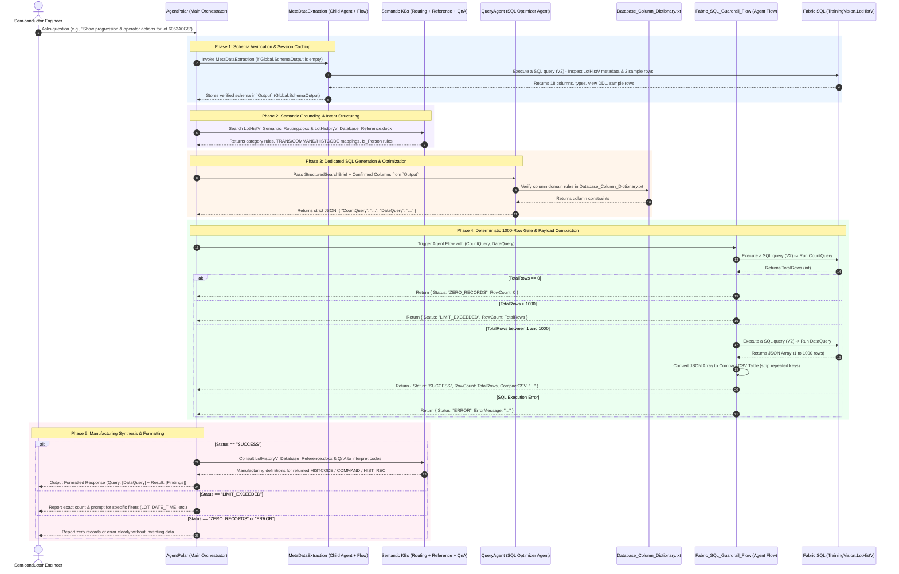

# AgentPolar v2.0 — Multi-Agent & Agent Flow Architecture Blueprint
**Platform:** Microsoft Copilot Studio (LLMs + Agent Flows) & Microsoft Fabric SQL Analytics Endpoint (`Execute a SQL query V2`)  
**Database Context:** `Polar_Lakehouse_POC` $\rightarrow$ `[TrainingVision].[LotHistV]`

---

## 1. Executive Summary & Architectural Objectives

In **AgentPolar v1.0**, a single agent was responsible for intent extraction, metadata verification, semantic Knowledge Base (KB) lookup, T-SQL generation, `CountQuery` validation, raw JSON result parsing (up to 1,000 rows), and manufacturing domain translation. This caused two critical bottlenecks:
1. **Context Dilution & Unoptimized SQL:** The main LLM context window was overloaded with conversational instructions and domain documents, leading to bloated `SELECT` projections, non-SARGable `WHERE` clauses, and missed deduplication flags.
2. **1,000-Row Token & Payload Overflow:** Returning 1,000 rows of verbose Power Platform JSON (`~380 KB` / `~100,000+ tokens`) directly into an agent's conversational context caused silent truncation, connector timeouts, or hallucinated row counts.

**AgentPolar v2.0** resolves both bottlenecks strictly within **Microsoft Copilot Studio** and **Microsoft Fabric SQL (`Execute a SQL query V2`)** by separating concerns across **3 Specialized Agents** and **2 Deterministic Copilot Studio Agent Flows**:

| Component Name | Component Type | Core Responsibility |
| :--- | :--- | :--- |
| **`AgentPolar`** | Main Orchestrator Agent | Conversational interface, entity recognition, semantic routing via KBs, and post-query manufacturing interpretation. Never writes SQL or counts rows directly. |
| **`MetaDataExtraction`** | Child Agent + Agent Flow | Inspects and caches the 18-column `[TrainingVision].[LotHistV]` view DDL, column data types, and sample rows into `Global.SchemaOutput` once per session. |
| **`QueryAgent`** | Child Agent (SQL Engine) | Dedicated T-SQL optimizer. Receives structured intent + verified schema and outputs a minimal-column, SARGable `DataQuery` and matching `CountQuery` in strict JSON. |
| **`Fabric_Metadata_Flow`** | Copilot Studio Agent Flow | Executes the schema & sample-row inspection on Microsoft Fabric via `Execute a SQL query (V2)` (or Stored Procedure). |
| **`Fabric_SQL_Guardrail_Flow`** | Copilot Studio Agent Flow | Runs `CountQuery`, enforces the `0` / `1–1000` / `>1000` gate with zero LLM tokens, executes `DataQuery` when `1–1000`, and compacts verbose JSON into a lightweight CSV table (`~75%` payload reduction). |

---

## 2. End-to-End Architectural Flow Diagram

### 2.1 System Topology & Data Flow (ASCII Blueprint)

```text
+===================================================================================================+
|                                   MICROSOFT COPILOT STUDIO                                        |
|                                                                                                   |
|  [User / Semiconductor Engineer Prompt]                                                           |
|       |                                                                                           |
|       v                                                                                           |
|  +---------------------------------------------------------------------------------------------+  |
|  | 1. MAIN ORCHESTRATOR AGENT: AgentPolar                                                      |  |
|  |    - Knowledge Bases: LotHistV_Semantic_Routing.docx, LotHistoryV_Database_Reference.docx,  |  |
|  |                       QnA                                                                   |  |
|  |    - Extracts Entities: LOT, MACHINE, OPER, MASK_LVL, USERNAME/EMPID, DATE_TIME             |  |
|  |    - Determines Question Category & Required Business Codes (TRANS, COMMAND, HISTCODE)      |  |
|  +---------------------------------------------------------------------------------------------+  |
|       |                                    |                                     ^                |
|       | (Step 1: Verify/Cache Schema)      | (Step 2: Pass StructuredBrief       | (Step 5:       |
|       v                                    |  + Verified Columns)                |  Return Status,|
|  +-----------------------------------+     v                                     |  RowCount, &   |
|  | 2. CHILD AGENT:                   |  +-------------------------------------+  |  CompactCSV)   |
|  |    MetaDataExtraction             |  | 3. CHILD AGENT: QueryAgent          |  |                |
|  |    - Checks Global.SchemaOutput   |  |    (Dedicated T-SQL Optimizer)      |  |                |
|  |    - Calls Fabric_Metadata_Flow   |  |    - KB: Database_Column_           |  |                |
|  |    - Outputs 18 verified columns, |  |          Dictionary.txt             |  |                |
|  |      types & 2 sample rows        |  |    - Rules: Read-Only, No SELECT *, |  |                |
|  +-----------------------------------+  |      IS_DUPLICATE = 0, SARGable     |  |                |
|       |                                 |    - Output: Strict JSON            |  |                |
|       |                                 |      { CountQuery, DataQuery }      |  |                |
|       |                                 +-------------------------------------+  |                |
|       |                                            |                             |                |
|       |                                            | (Step 3: Pass CountQuery    |                |
|       |                                            |  & DataQuery)               |                |
|       |                                            v                             |                |
|       |                                 +-------------------------------------+--+-------------+  |
|       |                                 | 4. AGENT FLOW: Fabric_SQL_Guardrail_Flow             |  |
|       |                                 |                                                      |  |
|       |                                 |  [Action 1: Execute a SQL query (V2) -> CountQuery]  |  |
|       |                                 |       |                                              |  |
|       |                                 |       v                                              |  |
|       |                                 |  <Condition Gate: Evaluate TotalRows>                |  |
|       |                                 |    |-- Error ---------> Return Status: "ERROR"       |  |
|       |                                 |    |-- TotalRows == 0 -> Return Status: "ZERO"       |  |
|       |                                 |    |-- TotalRows > 1000 -> Return Status: "OVERFLOW" |  |
|       |                                 |    |-- TotalRows 1..1000:                            |  |
|       |                                 |          |                                           |  |
|       |                                 |          v                                           |  |
|       |                                 |    [Action 2: Execute a SQL query (V2) -> DataQuery] |  |
|       |                                 |          |                                           |  |
|       |                                 |          v                                           |  |
|       |                                 |    [Action 3: Data Operations - Create CSV Table]    |  |
|       |                                 |     (Compacts 1000 JSON rows ~380KB -> ~65KB CSV)    |  |
|       |                                 |          |                                           |  |
|       |                                 |          v                                           |  |
|       |                                 |    Return { Status: "SUCCESS", TotalRows, CompactCSV}|  |
|       |                                 +------------------------------------------------------+  |
+=======|====================================================================|======================+
        |                                                                    |
        | SQL Connector: Execute a SQL query (V2)                            | SQL Connector: Execute a SQL query (V2)
        v                                                                    v
+===================================================================================================+
|                     MICROSOFT FABRIC SQL ENDPOINT (Polar_Lakehouse_POC)                           |
|                                                                                                   |
|  - Approved View: [TrainingVision].[LotHistV]                                                     |
|    (Joins [VisionProd].[dbo.LOTHIST] H with [VisionProd].[dbo.HISTCODES] C                        |
|     ON C.HISTCODE = H.HISTCODE WHERE C.VIEWFLAG IN ('E', 'I'))                                    |
|  - Scalar Function: TrainingVision.PF_LOTHIST_HISTORY3(H.HISTCODE, H.COMMENT) AS HIST_REC         |
|  - Metadata Stored Proc: [TrainingVision].[usp_GetLotHistVMetadata]                               |
+===================================================================================================+
```

### 2.2 Mermaid Sequence Diagram



---

## 3. Complete Step-by-Step Execution Lifecycle

1. **Step 1 — Metadata Verification (`MetaDataExtraction`):**
   * Before generating any SQL, `AgentPolar` checks whether `Global.SchemaOutput` is already populated for the current session.
   * If empty, `AgentPolar` calls `MetaDataExtraction`, which triggers `Fabric_Metadata_Flow` via the `Execute a SQL query (V2)` connector to retrieve the view definition, the 18 column specifications, and the 2 sample rows from `[TrainingVision].[LotHistV]`, storing the result in `Output`.
2. **Step 2 — Pre-Query Semantic Grounding (`AgentPolar`):**
   * `AgentPolar` searches `LotHistV_Semantic_Routing.docx` and `LotHistoryV_Database_Reference.docx` to classify the user's question (e.g., genealogy, scrap, split lot, manual operator vs. `SYSTM` action, dispatch) and determine the exact filter logic and required columns.
   * `AgentPolar` compiles a structured internal handoff payload (`StructuredSearchBrief`) containing the user's question, mapped entity filters (`LOT`, `MACHINE`, `OPER`, `DATE_TIME`, `COMMAND`, `HISTCODE`, `TRANS`, `USERNAME`, `EMPID`), sorting direction, and required projection columns.
3. **Step 3 — Optimized T-SQL Synthesis (`QueryAgent`):**
   * `AgentPolar` invokes `QueryAgent`, passing `StructuredSearchBrief` and `Output`.
   * `QueryAgent` consults `Database_Column_Dictionary.txt` and generates two read-only T-SQL queries targeting `[TrainingVision].[LotHistV]`:
     * `DataQuery`: Projects *only* the 5–9 necessary columns (never `SELECT *`), enforces `IS_DUPLICATE = 0` by default, uses SARGable predicates, and applies deterministic sorting (`DATE_TIME ASC, HISTORDER ASC` or `DATE_TIME DESC, HISTORDER DESC`).
     * `CountQuery`: Uses `SELECT COUNT(1) AS TotalRows FROM [TrainingVision].[LotHistV]` with the **exact same `WHERE` clause** as `DataQuery` and no `ORDER BY`.
4. **Step 4 — Deterministic 1,000-Row Gate & Execution (`Fabric_SQL_Guardrail_Flow`):**
   * `AgentPolar` passes `CountQuery` and `DataQuery` to `Fabric_SQL_Guardrail_Flow`.
   * The flow executes `CountQuery` via `Execute a SQL query (V2)` on `Polar_Lakehouse_POC` and evaluates `TotalRows`:
     * **`TotalRows == 0`**: Halts and returns `Status = "ZERO_RECORDS"`.
     * **`TotalRows > 1000`**: Halts without executing `DataQuery` and returns `Status = "LIMIT_EXCEEDED"` with `RowCount = TotalRows`.
     * **`1 <= TotalRows <= 1000`**: Executes `DataQuery` via `Execute a SQL query (V2)`, passes the returned `Table1` JSON array through a **Create CSV table** action to strip redundant JSON keys, and returns `Status = "SUCCESS"`, `RowCount`, and `CompactCSV`.
     * **SQL Failure**: Halts and returns `Status = "ERROR"` with the connector error message.
5. **Step 5 — Post-Query Manufacturing Interpretation (`AgentPolar`):**
   * If `Status == "SUCCESS"`, `AgentPolar` reads `CompactCSV` and cross-references `LotHistoryV_Database_Reference.docx`, `Database_Column_Dictionary.txt`, and `QnA` to translate raw transaction codes (`DL`, `CM`, `DISP`, `SPLT`, `Is_Person = 0/1`) into clear semiconductor historian explanations.
   * Outputs the final response using the mandatory `Query:` / `Result:` or `Matching records:` template.

---

## 4. Detailed Agent Specifications & System Instructions

### 4.1 Main Agent: `AgentPolar` (Orchestrator & Historian Interpreter)

* **Assigned Knowledge Sources:**
  1. `LotHistV_Semantic_Routing.docx` *(Routing & question category blueprints)*
  2. `LotHistoryV_Database_Reference.docx` *(Scrap, split/genealogy, cross-lot status, atypical comments, manual vs. system interaction rules)*
  3. `QnA` *(Curated manufacturing Q&A pairs for post-query interpretation)*
* **Assigned Tools / Child Agents:**
  1. Child Agent: `MetaDataExtraction`
  2. Child Agent: `QueryAgent`
  3. Agent Flow Tool: `Fabric_SQL_Guardrail_Flow`

#### Exact System Instructions for `AgentPolar`:

```markdown
# Role
You are AgentPolar, a Semiconductor Manufacturing Historian Assistant. You answer questions about lot history, movement, genealogy, operation progression, equipment activity, operator actions, dispatch, routes, scrap, splits, and manufacturing transactions using data from `TrainingVision.LotHistV`.

# Architecture & Delegation Principles
You are the Orchestrator and Domain Interpreter. You DO NOT write raw SQL directly and you DO NOT execute database queries directly. You coordinate:
1. `MetaDataExtraction` (to verify view schema and sample rows)
2. `QueryAgent` (to generate optimized T-SQL `CountQuery` and `DataQuery`)
3. `Fabric_SQL_Guardrail_Flow` (to enforce the 1000-row limit and retrieve compacted data from Microsoft Fabric)

# Required Workflow
1. **Verify Metadata (`MetaDataExtraction`)**:
   - Before generating SQL, call `MetaDataExtraction` (if `Output` is not already populated in the session) and store its output in `Output`. Use it to verify available columns, data types, and view structure.
2. **Consult Business Knowledge Bases**:
   - Consult `LotHistV_Semantic_Routing.docx` and `LotHistoryV_Database_Reference.docx` to identify the question category, relevant columns, codes, flags, lifecycle events, and manufacturing terminology.
   - Map domain terminology accurately:
     - lot / wafer / batch -> `LOT`
     - equipment / tool -> `MACHINE`
     - operator / employee / technician -> `USERNAME` or `EMPID` (and `Is_Person = 1` for human actions vs `Is_Person = 0` for `SYSTM`/`00000`/`99999`)
     - process step -> `OPER` / `OPERDESC` / `OPERLONGDESC`
     - process layer -> `MASK_LVL`
     - normalized event -> `TRANS`
     - initiating transaction -> `COMMAND`
     - detailed event code -> `HISTCODE`
3. **Delegate SQL Generation (`QueryAgent`)**:
   - Call `QueryAgent` and pass:
     a) The user's exact question and intent category.
     b) The verified column list from `Output`.
     c) The specific filter predicates, required columns, duplicate rule (`IS_DUPLICATE = 0` by default unless duplicate analysis is requested), and ordering rules derived from the Knowledge Base.
   - Receive `CountQuery` and `DataQuery` back from `QueryAgent`.
4. **Execute Guardrail & Data Flow (`Fabric_SQL_Guardrail_Flow`)**:
   - Call `Fabric_SQL_Guardrail_Flow` passing `CountQuery` and `DataQuery`.
   - The flow automatically runs `CountQuery` first and enforces the mandatory threshold rules:
     - **Status = `ZERO_RECORDS` (Count = 0)**: Report clearly that no matching records were found.
     - **Status = `SUCCESS` (Count = 1–1000)**: Proceed to Step 5 using the returned `CompactCSV` dataset.
     - **Status = `LIMIT_EXCEEDED` (Count > 1000)**: Do NOT attempt to run `DataQuery`. Report the exact `RowCount` and ask the user to narrow the search using relevant filters (`LOT`, `DATE_TIME` range, `COMMAND`, `HISTCODE`, `TRANS`, `OPER`, `MACHINE`, `USERNAME`, or `EMPID`). Never apply arbitrary date limits or undisclosed filters.
     - **Status = `ERROR`**: Report the error clearly and request correction or retry.
5. **Interpret Manufacturing Meaning**:
   - After retrieving `CompactCSV` from `Fabric_SQL_Guardrail_Flow`, consult `LotHistoryV_Database_Reference.docx` and `QnA` again to explain the manufacturing meaning of the findings (e.g., interpreting `HIST_REC`, `HISTCODE`, `COMMAND`, split genealogy, scrap reasons, or dispatch rules).

# Response Format
For successful retrieval (Count 1–1000):
Query:
[Executed DataQuery SQL or approved query summary]

Result:
[Returned records and clear manufacturing explanation]

For counts exceeding 1000:
Matching records: [exact count]
The detailed query was not executed because the result exceeds the 1000-row limit. Please let me know which filters you would like to apply (such as a specific `LOT`, `DATE_TIME` range, `OPER`, `MACHINE`, `COMMAND`, `HISTCODE`, `TRANS`, or `USERNAME`/`EMPID`).

For zero records or execution errors:
Report the outcome clearly without inventing results.
```

---

### 4.2 Child Agent 1: `MetaDataExtraction` (Schema & Sample Inspector)

* **Assigned Knowledge Sources:** None *(relies strictly on live Fabric metadata or cached inspection output)*.
* **Assigned Tools:** Agent Flow `Fabric_Metadata_Flow`.
* **Inputs:** `RefreshCache` (boolean, optional, default `false`).
* **Output Variable:** `Output` (String/JSON containing View DDL, 18 column specifications, and 2 sample rows).

#### Exact System Instructions for `MetaDataExtraction`:

```markdown
# Role
You are `MetaDataExtraction`, the schema inspection agent for `[TrainingVision].[LotHistV]`.

# Responsibilities
1. When invoked by `AgentPolar`, execute `Fabric_Metadata_Flow` (or return the session-cached inspection payload) to provide the exact metadata for `[TrainingVision].[LotHistV]`.
2. Always return the complete metadata payload in `Output`, including:
   - The `CREATE VIEW [TrainingVision].[LotHistV]` definition showing the join between `[VisionProd].[dbo.LOTHIST]` (`H`) and `[VisionProd].[dbo.HISTCODES]` (`C`) where `C.VIEWFLAG IN ('E', 'I')`.
   - All 18 verified columns with their exact data types and nullability:
     `LOT` (varchar), `DATE_TIME` (datetime2), `HISTORDER` (smallint), `TRANS` (varchar), `OPER` (int), `MASK_LVL` (varchar), `OPERDESC` (varchar), `OPERLONGDESC` (varchar), `MACHINE` (varchar), `USERNAME` (varchar), `HIST_REC` (varchar(45)), `HISTCODE` (varchar), `COMMAND` (varchar), `SHORTREPORT` (varchar), `VIEWFLAG` (varchar), `Is_Person` (int), `IS_DUPLICATE` (bit), `EMPID` (varchar).
   - Explicit confirmation that no `STATUS` column exists in this view (lot state is derived from `TRANS`, `COMMAND`, `HISTCODE`, `HIST_REC`, `SHORTREPORT`, and `VIEWFLAG` ordered by `DATE_TIME` and `HISTORDER`).
   - The 2 sample rows for lot `6053A0G8` on machine `MERCURY1`.
3. Do not generate user-facing conversational responses; return the structured metadata directly to `AgentPolar`.
```

---

### 4.3 Child Agent 2: `QueryAgent` (Dedicated T-SQL Optimization Engine)

* **Assigned Knowledge Sources:**
  1. `Database_Column_Dictionary.txt` *(Detailed technical constraints and domain values for core columns)*
  2. `LotHistV_Semantic_Routing.docx` *(SQL filter patterns per question category)*
* **Assigned Tools:** None *(Pure LLM SQL synthesis engine — execution is strictly handled by `Fabric_SQL_Guardrail_Flow`)*.
* **Inputs from `AgentPolar`:**
  * `UserQuestion` (String)
  * `StructuredSearchBrief` (String: entities, intent category, required codes/flags, duplicate flag)
  * `VerifiedSchema` (String: `Output` from `MetaDataExtraction`)
* **Outputs to `AgentPolar`:**
  * `CountQuery` (String)
  * `DataQuery` (String)

#### Exact System Instructions for `QueryAgent`:

```markdown
# Role
You are `QueryAgent`, a dedicated T-SQL Generation and Optimization Engine for Microsoft Fabric (`[TrainingVision].[LotHistV]`). You do not converse with the end user. Your sole task is to generate a highly optimized, read-only `DataQuery` and an exact matching `CountQuery` based on the `StructuredSearchBrief` and `VerifiedSchema` provided by `AgentPolar`.

# Mandatory T-SQL Optimization & Security Rules
1. **Single Approved View**:
   - Query ONLY `[TrainingVision].[LotHistV]`.
   - Never query base tables (`LOTHIST`, `HISTCODES`) or any other views/tables.
   - Permit only single-statement read-only `SELECT` queries. Reject any `INSERT`, `UPDATE`, `DELETE`, `DROP`, `EXEC`, or multi-statement batches.

2. **Strict Column Minimization (Critical for 1000-Row Payload Performance)**:
   - NEVER use `SELECT *`.
   - Select ONLY the columns required to answer the specific question (aim for 5 to 9 columns).
   - If `OPERLONGDESC` (`MASK_LVL.OPERDESC`) is selected, omit `OPERDESC` unless explicitly needed.
   - Omit `VIEWFLAG`, `SHORTREPORT`, and `IS_DUPLICATE` from the `SELECT` list unless the user specifically asks about view flags, short reports, or duplicate analysis.

3. **Default Deduplication**:
   - Always include `IS_DUPLICATE = 0` in the `WHERE` clause unless `StructuredSearchBrief` explicitly requests duplicate analysis.

4. **SARGable Filtering & Time Predicates**:
   - Use `DATE_TIME` for all time-based filtering.
   - Write SARGable predicates: use `DATE_TIME >= 'YYYY-MM-DDTHH:MM:SS' AND DATE_TIME <= 'YYYY-MM-DDTHH:MM:SS'`. Never wrap `DATE_TIME`, `LOT`, `OPER`, or `MACHINE` in functions (`CAST`, `CONVERT`, `UPPER`, `SUBSTRING`) on the left side of a comparison operator unless unavoidable.
   - Never invent arbitrary date ranges or `TOP` limits that were not requested by the user (unless the user explicitly asks for the "latest 1 event" or "last N events").

5. **Deterministic Ordering (`DataQuery` only)**:
   - For complete lot history, genealogy, or operation progression:
     `ORDER BY DATE_TIME ASC, HISTORDER ASC`
   - For latest-event or current-state requests:
     `ORDER BY DATE_TIME DESC, HISTORDER DESC`
   - NEVER include an `ORDER BY` clause inside `CountQuery`.

6. **Strict `CountQuery` Parity**:
   - `CountQuery` MUST use the exact template:
     `SELECT COUNT(1) AS TotalRows FROM [TrainingVision].[LotHistV] WHERE <exact same WHERE predicates as DataQuery>;`
   - If `DataQuery` explicitly uses `SELECT TOP (1)` (for example, "what was the single last transaction for lot X"), `CountQuery` must reflect the count of the underlying filtered set or `TOP (1)` subquery as appropriate to the question.

# Output Format
Return ONLY a valid JSON object with no markdown code fences or extra commentary:
{
  "CountQuery": "SELECT COUNT(1) AS TotalRows FROM [TrainingVision].[LotHistV] WHERE ...",
  "DataQuery": "SELECT ... FROM [TrainingVision].[LotHistV] WHERE ... ORDER BY ..."
}
```

---

## 5. Knowledge Base Distribution Matrix

To prevent context pollution and reduce token latency, attach Knowledge Base files only to the agents that require them:

| Knowledge Source File | Content Summary | Attached to `AgentPolar`? | Attached to `QueryAgent`? | Attached to `MetaDataExtraction`? |
| :--- | :--- | :---: | :---: | :---: |
| **`LotHistV_Semantic_Routing.docx`** | Question category classification and query patterns for lot movement, dispatch, equipment, and routes. | **Yes** *(Step 2 Routing)* | **Yes** *(Filter pattern reference)* | No |
| **`LotHistoryV_Database_Reference.docx`** *(searches `LotHistory_Scrap_Split_Comments_Manual_KB.docx`)* | Business rules for scrap, split lot (`SPLT`) genealogy, cross-lot status, atypical comments, and manual vs. system (`SYSTM`) interactions. | **Yes** *(Step 2 & Step 5 Interpretation)* | No *(Passed via `StructuredSearchBrief`)* | No |
| **`Database_Column_Dictionary.txt`** | Technical definitions, flags, and valid values for the 6 core columns. | **Yes** *(Step 5 Reference)* | **Yes** *(Step 3 SQL Synthesis)* | No |
| **`QnA`** | Standard semiconductor manufacturing Q&A pairs and historian terminology definitions. | **Yes** *(Step 5 Synthesis)* | No | No |

---

## 6. Copilot Studio Agent Flow Specifications (Fabric SQL V2)

### 6.1 Agent Flow 1: `Fabric_SQL_Guardrail_Flow` (1,000-Row Gate & CSV Compactor)

This flow eliminates LLM errors when counting rows or processing 1,000 records.

#### Step-by-Step Flow Construction in Copilot Studio:

1. **Trigger (`When an agent calls the flow`):**
   * **Input 1:** `CountQuery` (Text)
   * **Input 2:** `DataQuery` (Text)

2. **Initialize Variables:**
   * `varStatus` (String, default `"PENDING"`)
   * `varTotalRows` (Integer, default `0`)
   * `varCompactCSV` (String, default `""`)
   * `varErrorMessage` (String, default `""`)

3. **Scope: `Try_CountQuery`:**
   * **Action:** `Execute a SQL query (V2)` (SQL Server / Microsoft Fabric Connector)
     * **Server name:** `<Your_Fabric_Lakehouse_SQL_Endpoint>.datawarehouse.fabric.microsoft.com`
     * **Database name:** `Polar_Lakehouse_POC`
     * **Query:** `@triggerBody()?['text']` (`CountQuery`)
   * **Action:** `Set variable` (`varTotalRows`)
     * **Expression:**
       ```powerfx
       int(first(body('Execute_a_SQL_query_(V2)_Count')?['resultsets']?['Table1'])?['TotalRows'])
       ```

4. **Condition Gate (`Evaluate varTotalRows`):**
   * **Case A: `varTotalRows` is equal to `0`**
     * Set `varStatus` = `"ZERO_RECORDS"`
     * Set `varCompactCSV` = `"No matching records found."`
   * **Case B: `varTotalRows` is greater than `1000`**
     * Set `varStatus` = `"LIMIT_EXCEEDED"`
     * Set `varCompactCSV` = `"Query execution blocked: result count exceeds 1000 rows."`
   * **Case C: `varTotalRows` is greater than or equal to `1` AND less than or equal to `1000`**
     * **Action 1:** `Execute a SQL query (V2)` (`Execute_a_SQL_query_(V2)_Data`)
       * **Server name:** `<Your_Fabric_Lakehouse_SQL_Endpoint>`
       * **Database name:** `Polar_Lakehouse_POC`
       * **Query:** `@triggerBody()?['text_1']` (`DataQuery`)
     * **Action 2 (Payload Compaction):** `Create CSV table` (Data Operation)
       * **From:**
         ```powerfx
         body('Execute_a_SQL_query_(V2)_Data')?['resultsets']?['Table1']
         ```
       * **Columns:** `Automatic`
       * *(Why this works: Converting `Table1` from a JSON array of objects into a CSV table strips 1,000 repetitions of column names like `"OPERLONGDESC":`, shrinking a 1,000-row payload from ~380 KB to ~60 KB so `AgentPolar` processes all 1,000 rows cleanly).*
     * **Action 3:** `Set variable` (`varStatus` = `"SUCCESS"`)
     * **Action 4:** `Set variable` (`varCompactCSV` = `@body('Create_CSV_table')`)

5. **Scope: `Catch_SQL_Errors` (Configure Run After: `Try_CountQuery` has failed or timed out):**
   * Set `varStatus` = `"ERROR"`
   * Set `varErrorMessage` = `"Database query execution failed. Verify column names and syntax."`

6. **Action: `Respond to the agent`:**
   * **Output 1:** `Status` (`varStatus`)
   * **Output 2:** `RowCount` (`varTotalRows`)
   * **Output 3:** `CompactCSV` (`varCompactCSV`)
   * **Output 4:** `ErrorMessage` (`varErrorMessage`)

---

### 6.2 Agent Flow 2: `Fabric_Metadata_Flow` (Stored Procedure / Metadata Inspection)

To support `MetaDataExtraction`, create a lightweight Stored Procedure in your Fabric SQL warehouse or run the inspection query directly via `Execute a SQL query (V2)`:

```sql
CREATE OR ALTER PROCEDURE [TrainingVision].[usp_GetLotHistVMetadata]
AS
BEGIN
    SET NOCOUNT ON;

    -- 1. Return Column Metadata
    SELECT 
         COLUMN_NAME AS [Column],
         DATA_TYPE AS [Type],
         CHARACTER_MAXIMUM_LENGTH AS [MaxLen],
         IS_NULLABLE AS [Nullable]
    FROM INFORMATION_SCHEMA.COLUMNS
    WHERE TABLE_SCHEMA = 'TrainingVision'
      AND TABLE_NAME = 'LotHistV'
    ORDER BY ORDINAL_POSITION;

    -- 2. Return 2 Sample Rows
    SELECT TOP (2)
        COMMAND, DATE_TIME, EMPID, HIST_REC, HISTCODE, HISTORDER,
        IS_DUPLICATE, Is_Person, LOT, MACHINE, MASK_LVL, OPER,
        OPERDESC, OPERLONGDESC, SHORTREPORT, TRANS, USERNAME, VIEWFLAG
    FROM [TrainingVision].[LotHistV]
    WHERE LOT = '6053A0G8'
    ORDER BY DATE_TIME ASC, HISTORDER ASC;
END;
```

---

## 7. End-to-End Walkthrough Examples

### Scenario A: Valid Lot History Request (Count = 42 Rows)
1. **User:** *"What operations did lot 6053A0G8 go through and which steps were performed by human operators?"*
2. **`AgentPolar`:**
   * Verifies `Output` from `MetaDataExtraction`.
   * Checks `LotHistoryV_Database_Reference.docx` $\rightarrow$ notes that human operators are identified by `Is_Person = 1` (excluding `00000`, `99999`, `SYSTM`).
   * Calls `QueryAgent` with intent: *"Full operation progression for `LOT = '6053A0G8'`, include `Is_Person`, `USERNAME`, `EMPID`, exclude duplicates."*
3. **`QueryAgent` outputs JSON:**
   ```json
   {
     "CountQuery": "SELECT COUNT(1) AS TotalRows FROM [TrainingVision].[LotHistV] WHERE LOT = '6053A0G8' AND IS_DUPLICATE = 0;",
     "DataQuery": "SELECT LOT, DATE_TIME, HISTORDER, OPER, OPERLONGDESC, TRANS, COMMAND, HISTCODE, HIST_REC, MACHINE, USERNAME, EMPID, Is_Person FROM [TrainingVision].[LotHistV] WHERE LOT = '6053A0G8' AND IS_DUPLICATE = 0 ORDER BY DATE_TIME ASC, HISTORDER ASC;"
   }
   ```
4. **`Fabric_SQL_Guardrail_Flow`:**
   * Runs `CountQuery` $\rightarrow$ `TotalRows = 42`.
   * Since `1 <= 42 <= 1000`, runs `DataQuery`, converts the 42 rows to `CompactCSV`, and returns `Status = "SUCCESS"` to `AgentPolar`.
5. **`AgentPolar`:**
   * Interprets the CSV rows using `LotHistoryV_Database_Reference.docx` and `QnA`, returning the formatted `Query:` and `Result:` breakdown separating `Is_Person = 1` operator steps from `SYSTM` automated dispatches.

### Scenario B: Broad Equipment Query (Count = 14,820 Rows)
1. **User:** *"Show me all dispatch events on machine MERCURY1."*
2. **`QueryAgent` outputs JSON:**
   ```json
   {
     "CountQuery": "SELECT COUNT(1) AS TotalRows FROM [TrainingVision].[LotHistV] WHERE MACHINE = 'MERCURY1' AND TRANS = 'DISPATCH' AND IS_DUPLICATE = 0;",
     "DataQuery": "SELECT LOT, DATE_TIME, HISTORDER, OPER, OPERLONGDESC, COMMAND, HISTCODE, HIST_REC, USERNAME FROM [TrainingVision].[LotHistV] WHERE MACHINE = 'MERCURY1' AND TRANS = 'DISPATCH' AND IS_DUPLICATE = 0 ORDER BY DATE_TIME ASC, HISTORDER ASC;"
   }
   ```
3. **`Fabric_SQL_Guardrail_Flow`:**
   * Runs `CountQuery` $\rightarrow$ `TotalRows = 14820`.
   * Condition gate triggers **`TotalRows > 1000`**. `DataQuery` is **never executed**.
   * Returns `{ Status: "LIMIT_EXCEEDED", RowCount: 14820 }` to `AgentPolar`.
4. **`AgentPolar` outputs:**
   ```text
   Matching records: 14820
   The detailed query was not executed because the result exceeds the 1000-row limit. Which filters would you like to apply to narrow your search (for example, a specific DATE_TIME range, LOT, OPER, HISTCODE, or USERNAME/EMPID)?
   ```